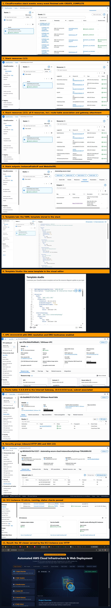

# AWS CloudFormation 3D Infrastructure Viewer


**Automated AWS Cloud Infrastructure & Web Presentation Deployment.**
One CloudFormation **YAML** template builds a custom VPC, public subnet, internet gateway, route table, security group and an Ubuntu EC2 server. The server installs Apache at boot and publishes an interactive **3D architecture viewer** (Three.js) by itself, with no manual setup.

Deployed and tested in **ap-south-1 (Mumbai)**. The stack reached `CREATE_COMPLETE` and the 3D page was served by the EC2 instance (screenshots below).

## Contents

- [Objective](#objective)
- [What was built](#what-was-built)
- [Architecture flow](#architecture-flow)
- [Deployment screenshots](#deployment-screenshots)
- [CloudFormation template (YAML)](#cloudformation-template-yaml)
- [3D viewer source code](#3d-viewer-source-code)
- [How the web page gets onto the server](#how-the-web-page-gets-onto-the-server)
- [How to deploy](#how-to-deploy)
- [Challenges and fixes](#challenges-and-fixes)
- [Troubleshooting](#troubleshooting)

## Objective

Use Infrastructure as Code (IaC) to deploy a secure, repeatable and fully automated cloud environment (VPC, subnet, security group and EC2) with AWS CloudFormation, and present it through an interactive 3D web page.

## What was built

| Component | What it does | How it is done in the template |
|---|---|---|
| **Custom VPC** | An isolated private network, CIDR `10.0.0.0/16` | `AWS::EC2::VPC` with `EnableDnsSupport: true` and `EnableDnsHostnames: true` |
| **Internet Gateway** | Connects the VPC to the public internet | `AWS::EC2::InternetGateway` attached with `AWS::EC2::VPCGatewayAttachment` |
| **Public Subnet** | Holds the public-facing server, CIDR `10.0.1.0/24` | `AWS::EC2::Subnet` with `MapPublicIpOnLaunch: true`, so new instances get a public IP automatically |
| **Route Table** | Sends internet traffic to the gateway | `AWS::EC2::RouteTable` and `AWS::EC2::Route` (`0.0.0.0/0` to the Internet Gateway), linked with `AWS::EC2::SubnetRouteTableAssociation` |
| **Security Group** | Firewall for the server | `AWS::EC2::SecurityGroup` with inbound **22** (SSH) and **80** (HTTP) |
| **EC2 Instance** | Free-tier style Ubuntu web server | `AWS::EC2::Instance`, `t3.micro`, in the public subnet with the security group attached |
| **User-Data script** | Sets up the web server on first boot | Installs `apache2`, then writes the 3D viewer to `/var/www/html/index.html` |

## Architecture flow

```
Internet -> Internet Gateway -> Route Table -> Public Subnet (10.0.1.0/24)
         -> Security Group (22, 80) -> EC2 (Ubuntu + Apache) -> 3D viewer page
                         all inside VPC 10.0.0.0/16
```

## Deployment screenshots

Captured from the AWS Console after deployment (region `ap-south-1`). AWS account IDs are blacked out. Click the image to open it full size.



The image shows, from top to bottom: stack events, stack resources (two parts), outputs, template tab, Template Studio, VPC, route table, security group, EC2 instance and the live 3D viewer.

## CloudFormation template (YAML)

This is the complete working template. Open the block below and use the copy button at its top right corner, then save it as `template.yaml` and upload it in CloudFormation.

<details>
<summary><b>Click to show the full template.yaml</b></summary>

````yaml
AWSTemplateFormatVersion: '2010-09-09'
Description: 'CloudFormation 3D Interactive Stack Viewer with Automated Web Deployment'

Resources:
  MyVPC:
    Type: 'AWS::EC2::VPC'
    Properties:
      CidrBlock: 10.0.0.0/16
      EnableDnsSupport: true
      EnableDnsHostnames: true
      Tags:
        - Key: Name
          Value: 3DViewer-VPC

  InternetGateway:
    Type: 'AWS::EC2::InternetGateway'
    Properties:
      Tags:
        - Key: Name
          Value: 3DViewer-IGW

  VPCGatewayAttachment:
    Type: 'AWS::EC2::VPCGatewayAttachment'
    Properties:
      VpcId: !Ref MyVPC
      InternetGatewayId: !Ref InternetGateway

  PublicSubnet:
    Type: 'AWS::EC2::Subnet'
    Properties:
      VpcId: !Ref MyVPC
      CidrBlock: 10.0.1.0/24
      MapPublicIpOnLaunch: true
      Tags:
        - Key: Name
          Value: 3DViewer-PublicSubnet

  PublicRouteTable:
    Type: 'AWS::EC2::RouteTable'
    Properties:
      VpcId: !Ref MyVPC
      Tags:
        - Key: Name
          Value: 3DViewer-RouteTable

  PublicRoute:
    Type: 'AWS::EC2::Route'
    DependsOn: VPCGatewayAttachment
    Properties:
      RouteTableId: !Ref PublicRouteTable
      DestinationCidrBlock: 0.0.0.0/0
      GatewayId: !Ref InternetGateway

  PublicSubnetRouteTableAssociation:
    Type: 'AWS::EC2::SubnetRouteTableAssociation'
    Properties:
      SubnetId: !Ref PublicSubnet
      RouteTableId: !Ref PublicRouteTable

  InstanceSecurityGroup:
    Type: 'AWS::EC2::SecurityGroup'
    Properties:
      GroupDescription: Enable SSH and HTTP access for 3D Viewer
      VpcId: !Ref MyVPC
      SecurityGroupIngress:
        - IpProtocol: tcp
          FromPort: 22
          ToPort: 22
          CidrIp: 0.0.0.0/0
        - IpProtocol: tcp
          FromPort: 80
          ToPort: 80
          CidrIp: 0.0.0.0/0
      Tags:
        - Key: Name
          Value: 3DViewer-SG

  MyEC2Instance:
    Type: 'AWS::EC2::Instance'
    # Wait for the internet route, otherwise apt-get can run before the VPC has internet access
    DependsOn:
      - PublicRoute
      - PublicSubnetRouteTableAssociation
    Properties:
      InstanceType: t3.micro
      ImageId: ami-0c7632fb77f35db43
      SubnetId: !Ref PublicSubnet
      SecurityGroupIds:
        - !Ref InstanceSecurityGroup
      # NOTE: plain Fn::Base64 (no !Sub) on purpose. The page below is gzip+base64 text,
      # so it fits the 16 KB UserData limit and nothing in it is read as ${variable}.
      UserData:
        Fn::Base64: |
          #!/bin/bash
          export DEBIAN_FRONTEND=noninteractive
          until apt-get update -y; do sleep 5; done
          until apt-get install -y apache2; do sleep 5; done
          systemctl enable --now apache2
          echo 'H4sIAAAAAAACA6193Y7bSJbmfT4Fyy6bpJOiSOonlVQya7JsV1UOymXDdle1Ybu3KTIksZIiOSSlzCy1gL6YywF6gAV6sbMXi1lgd4EF9nYw2MfpF9h9hD3nRAR/JGaW3TPVzkwqGHHixDnf+QsG1WdfPHv59O27V8+VZbmKz4/O8I8S+8nCe8CSB9jA/BD+rFjpK8HSzwtWeg9+8/ab3uSBbE78FfMebCJ2naV5+UAJ0qRkCXS7jsJy6YVsEwWsRx8MJUqiMvLjXhH4MfNsQ5HjevOo9IJ0w3IkXEZlzM4vfnqjPI3TdfhNmq/8MkoTVxk8U96UfnCl/AgDWX7W512PzoryFv+6eZqW215vtnAfWifWzB5Oe73MT1gMn+f2iePD58DPQ/ehPXbsAX6Mo4S5D53RwBmG8LFkN6X7cG7PR/NT+Lhal3D3dOgPZhP4mOYgHmiYz09PLQsaZvEaPg4ms3CO9xc5Ywl8HoaD09PpLL3pFdEvUbJwZ2kesrwHLdPMD0No6pVp5rJkoxX+nPX8nPm9KAEJY7thZTd61XGWlmW66uzLb1H33dGTbfeEKz9fRIlrSYKutTtCXW+LIE/juPepDO2OZml4u52DintzfxXFt676hi1SpvzmUjXe+st05Rs/sjz0E98o/KToFSyP5tMZaGyRp+skdHM/RAAs8C/ARAuiPIiZ4peKYz1SLOOh7TjWIDQ2fq6hGnVlNHqkT4M0TnOXN6KCKtm4ziS7UWz4NV1FSW/JosWydG3L2ix3R+Z17mfblX/D8efajmVllTj8dZmCHADiLN8i0Z4fR4vEDYAvloteUvbOOLsBgjM/XLBtYz2cJY4KyeZDy6pFPUL2hjCr0AcufF24DjJCgrzmLJ/AGPoM6mPAKU63tLd1UxD7q0xzgJQx3FwbgwkiRCwFuyuWMqFBtCAl2zZlhijWm/RHJAcpmLFzIBdzHqfX2zAqsti/decxu5n+vC7KaH7bEyYuBUVS60UlWxWyaeFn7hgXCMN6qAQXf1XcTohbZyxFwFkawMcDngUjSgFGvJUyHaNMnUqmrg2fizSOQoWPRIvWuwR+oDhyDaC3dV7AvFkaEfslqLOIyOOYzqho8mCmyVYQbvLaBkCrDUaDBNN1WQlzkUfhFH8BlFfQUjKktV4lhTtANhV7zkWIym6Jtyj9vASCSRqyoq0cEnUY5SwgvjlBosKxZKLXO0QutuqfI0eSu1SEPZbGd78Epw3zitm8FHKKkiX4h5JAID8ITt0lBgODrn9F5jTXHGKES1coz99qQ7SOxmof2oHjD08k9XkarIveJiqiWcy2oBwKAs7e+tG361Nxt5fO5+AM3VqaynKw7WKogelxZVbSkQzr4b9iomgPNLF0auYIRgIEujyQAPLnKBJ5QyEjtt1lFIYsAfoYkbdZKpSXMxBntGFTwcNgsmdGd/vzEfjzofXIwEA7GYbGQ2ts+fZQOSF/zuECw2bTMl0Hy57PcZukCRNcuNi0YdtG3xmAbncU+MnGr+E/i9Pgaio8vGU9mtZB4BGQWgIi6wX5M5ALSHqKMHSFYybF2FbbHTld7mgqAN5jG1htIdkFnXRMkXM2cA6MrHTRcmGHYWG8FxXG7agwuNvn3eOBWvpazHzNGY0MezQwLMO0HX3qJ5HIrxbo5pwC8rQ5pmpiaWZ61ba/h7Y1O53Yrbko8Tmcyh4b9gRmc05hriE4w7+5YrfzHJLGQsHZttYjnrQs/RBgaCn8f/tswsiTrp6otP3Olr5D1X8CWegJK4TFplVowaCkDCzxS2qH1NdlU2K4snRatswdR604xznwA8i5HC0dwcNgFo6YvWf1J/sjnTZQ26H8xAqWku46luvqEdwpBt7rc4YHPmcsicXRts0HZURzyLfvS59QcpiidQf6h+PhyXAyQ4dY5vG9VlpZUCvqyUTjF8hUQ3bjOoKUMlsDj8n2AI4jwxkYQ8cwJ6OurPIz/Od435qlWlphrbnke0Jk0eabR7/PTzSaJP7NIY5DM2fbhiopaDTDKrh0xxl8ktxIl4M73FZbtpNmjjFE4TaDVe+GclQubBRtH2CqPE0TIOwXxguWxKmxSpMUEraATVu21ViXYl4dGu2ucbvYHjq45v15V/Rvdgi2+zCnewFkb9u/UohCQM1Qgv1/JZWuEPI3KwbxWqvdxQR9gr6VKWp3Vgr56E7knHtpZp5eH6hlr2pFN8GTTyzQ+KwOOtddZ6JXZ3MUW3k+IrMPi4a1HTY2VQsDsc9ZXvRyFq4DFvZWqUhj8CMsEwN1He5oht3RWV/sHpz1xYYHlrnwJ4w2CpRdReE9wPpF7oiwHDccIOOSN6kqfHB+mUBgK8p8HZRrUL9fACZDplxH5VI53MyAWYEEkrTPL0Bu0MrCup+yR+0xVH9T5Sc2U56xLE5vV+BmgV8bCGTnFwrYOpBQfnz11FCeP3UUKLxBrIqfAEmwgiWwAUMzyB0NxY9jJSQiMOE8h2EgB+XdxYvvFal6U3kVBVeKD1hdZXA3KZU0R1AXhYLMKuiCTeVZ7i8U+JSnJQwyFL6fQF2jJFjirV/SdGWe9TMpXRJeQ7CInAdKFIqr87M+3Gx34dh80G4kOPKB/LJrJCXLewMRUHwcXZ0376H/5Pfo6vyM+1JqgcVvHih+Hvm92J+x2HvwClqidF0oRckAHH/5T3886/MB7YHAP9z987/Ukuvsl0AEak/wA7RI4n/+l3oQLbTJNyyTs40XHfcxB35w3taW6HUoNDQvTo2uqi7tPzzwA+bhN0/UBW4v8mAJqSNH7TMGfhhATIhXHs/WcTxVXqXXDCxSmd0S3DmyyyX4V/Pn4qwvKFczAaiiDOSQB7CQsswKt98PwuTnwgxwwnns58wEnPb9n/2bfhzNir4k1s9tZyI+gfeBFlwOJ1hRPj8KkEflnaelRuRZune+5S2ZpyqKauYsY36pRbpRBN7GO+//7kO4He56H8IPIf36sm+WrCi1jf7V79Uvt5ud+nt3Mz2K5tpFnoOdRAX91VJdzxnIJVFSc+VnGtDKjtWeoh5r5W3G0rmy8TxPTWc/g/jUr95pGyM6tnWzzKPVGyz9Nd0tAphG182fIY3Q1A+JqtNE6ms2VyFvV1I5hfoFNAHp1IS/0yPR+pJom2DQecQK4IgY0d5fGZuPuHCktXn8uIMdfduaZyPnyY6vjlVXEbNt+GzY85vEdb/2CzYedg/g95Q/wBqON++b3T+akOJFJV8eMRiTpEAZx3F76S2aSEkKbde+BSNJcrvm8N1UqP5vvXfycnnrFd55gUqPIXvQ+o/7C0MljAIvVesZtcZlq/F32ofiifaV21P0r3Tt/Ydrs/fxWNdcvb9YGeqXditoXD04/9IRQeDLQZOMdvaBN7sfChj+/ndnHxKg82UXlaJBpUXjiw/Xxzoy2eo+h+52V/ff/eFDoWsPFfNJ9zxBax4prGcXby+890fbKHRVDOPoUVUjgpuu+v/+6z/8o2rg4wFXtSGe5CnCSHlZdSuWaV666ndQcvoK5qklxI2cYbAqwB00IxaDMAaOC/6YqnFEe/6uekjxKHPVl/uhDPLhKA4FxWUaMyCzifI0wQiKwPSVAhKJmO3FZ3C8kKK5SsLK6zS/MpQ5ZD3XEDuNZnCVPJrKD2kJbnahRIUSwCpK7uCWPuc5dt+rP4o1Zj6kQAp5TiBuVFfKtzDq2r81lNcQ75jy1ofM3VBerWdxFChv1jPq/YZBIRGVt8q3kD1mFO1hAvUtLI+neUqYlljC04oHz5QVhMcY4goD4f7dGvwUyCL3NyyOkV0/TuF3ufRL4gtJiYQhQiIghDiGpcDtGfhlXBKS/Q2IoPfML32F+1CQSUo3MEUAuXIJomCQTIzRAdMgWJYSp4sFySlBleIYLk6c+VU7wcAOIPErDA7perFUGPS7beQk6O8wLTbVj8ZRAWB6w3X29PXzi7fP/8PTly9eff/87XPVSK9cyKTYzuBY/blIkxqn//HvJU4dk2PnrcBOBVJEFSg1RI0AEOAXSQzyDlj+DPDKOQP203UesAZKW/RcpTtH5NB9WyE0avcCEV6DykuW4ACf84hcmMplqQRgpTOmAAMFCJ2FhoJ5CbtGrQFCc9arkj2Q5wJwRkKHBSO/67gUzJfRikmonmGNcv5aLAeCMn0GRRJ6YDglmofAlSBtAbiNWGIKU1QCV0LCUquZYIrkimwdMKiASYGdUQLNOcIoI5gxQFYR9PFjhB6gudg3YOSTjF+CxFCfLllwRTdIiQ3K/jXYLeUT1fiND0UY1kHSlUgxzBh0YiKHBiwjZdIJ2EqKdNIVOpeiSf9hxbawlMo/gXaZXxDYEWLg7W7gBjom0h6qkvCNw92/1baQM0k88bX+yDUP8LVsq2edwj/VeMa4ZdIN0JZyTEJHfyXcF69LyNZVo1KAu31xC93d7VtIAVwVJnNdGOi60KjuDKlyofHDbnsdYAj3XxwZh/15O3QjyBBiDjvV96Aj1EASUQSoDprN23IErrmLXQ5Cdbfb6dyHSOFy/R/4jmAuPcdf/uk//99//ZP0HQNzD3+V83gNWi3aOkfVNuIShZqG0zisFpXnCXhN4Sj2buUV/VbgM0Qc4rfyysJEZKDdacQwRFWWBLfcSIizK8YyGrUCUILDQCMEx4NVYsUpeomnDfoIMYiQBRg/fORTLKRbKIRbyMktlNwtFNItLCq3MI8SMCEeYvZdxOUcutzyGDv3o7gwatEpWHYWCu6pSPtC5wo/SQohOJ73UNgQe9i8xDylQILPWMzKiIJfRQbKlc2BN1eisgrpGHFIDCyrgs7LHFMWKnKAGlH6yx//BwFnDt6pQs4mC+qg86f/JoEzBOBU1XsFGtsy6X99ewwVO1SIuLmFHGR5tEEIibykgZqaiqs0hnPMXCg/Rnm59mPIxDgBXq6B94FFKul1YwpBGsUfhQyLtDq9wWhDSRpKZZ3EGLCvGfd80FRB4/LZa+H5GqxIB7qIUMqgdPB545ExGoyrZV2+UvwwxDyAcS398Abgk+EhEfKUCYInJC0n9BRBhD9UVrwhDRHTApOSxDItSt4fUdGkIjFWUGj0FeyNPVs+9x6faEAemrG8jNB3Po3C/Gt8HtVSoGo8pwmfJcUbvhTyKHXrd5I77mkqV4RGJZB34IeiRSPV/qf/JdE0Mg/CcoUpTDDCFDLQGSiYCSPFOdD28DoSIxug2iemaJff/qRXmILBS3ANSVqNVfwgQFBAphiyuQ/5hangxAeEQJt+WWL4ocQE4IRsgE1SfjqfQ867SBURB8FxtL1OiB4pgr6I3MpSxUKSFuUGFH4SSWjE3VQzHAbpGjKFBHNcJsoQsTvmK7McwjrPIH4Cwyhqt0hBlNxp07XxzCRkASARzANTxXWBrrdsoeqvCKYXtK47B8AyxT3eEdOQNkJ/zILL0N1CHuWqhOrDoF7dP5i+RiaAoJLxATS5u28k2P8s0Tk22+VM293ZYC3OkMvU51ui0DPjAy5fFc3ir0lFuDs+XEKTM0EoUwroC+XRvIICIDLiAQ3+8An2nEHsrxOCAAAw4kn2HErlAzPpcnackbazc0bj2rEp2kgUZAQ+uRWmI8A4nRd+xpd4mb1MvideXAVl3KbKA1XCrivOYbWVwGohYlSlIIrohvQUg3a+hkgr+qYJXF+j4aBJNbCs0OOqQprRvhG34PxJid6vgnHfhUqtdkmk7S35DHc6zLyByP/5vyUiT8xmsVLh8Q1kRUXt06RDEmJYyNXvx94WKVnTNcUZ8Wxp5We8guSFiyR/TXkLVmkplXYI3qJIg4gcXuVrhNI4wtslW1ewTRnpj3cAyfqxuOVWE7eDJuYwt4VorDEpSVv7lLuQ4XJs8qSBQRYEnt3fULLIa3ka9O1PtOEgjVUuFrNa0FTCAio3UWgkPTHX3voPIEhauKOKaAOwLiwqHLZqDaiiIKkjhhq4rAShGp/hMjk2+F75octc1OD8L//cKCsm5l79XEH0G7Ef5XLrxbQC3IxDMXBikX+BhSYNkO4V4pqkUIXzvQ7kO+W210FIrZJz5WUicnbOA6SDuFFAHFBeSF7UVJ7vAQLI09kdVu2Qnc3OX2GiB6vQ3rz5TnfP+rNzyspLtJnEXzDatROevN44kgNh3dp3b9++EiMpmRBbiwVJo7WxSPtmUeYq0VyB6SgXpj7SWPYRj1srkOhHAWYQ2O1W5s7gbOdpXlcoM3abgh58SAJWaQuin1u+tvDaunWZLDCcuO+3lxl0KtMgjV21DGDMN5C3oEBcxzHepvIKIXyZNfG7M+4ZO7HkWLjqGPuxge11jKl1lsVRh+dlgVOj+8//vYHuU1P5zWydlGsq946r7QgB8XJgrqIgT2WORi4TU/liX48S4g1qmhytt7c6pFuOfXzEEzFE8AVkeoz1QMi5ZEhMibueRdM/tpyPQdaGMXN/R1TunRby+St2pLGF3N8+2Cttu3LJvvS2lfsXDF68uJR7V6uoZwUn44Ezn52czAejcDYcVJClLf5Qlv0t9jlToH5wtDwL4WbVLMzRSOrF5esE03Ze6pNwXKjjQtoGgHVewSoKo1470ufFViF5JWk4FXeUrePuJhOefvCM3goA0UP0lYbY3/h5//r6uo/H1vt01sfES0GmsWtNaivqNE08m6StaBQz9xJcb2CtmALux1WwZUz3yBXsZeyfspPUMljZyntLlarG5QoYgqihdupONXguU4WVZmoFRtt2AyG6AOq271vARg3UHarO3TYfsbnqwy/6syjpz/xi+SHxAbBcjUrvln8UOoTPitDZh6S4LUq2CspYKFXp9RJ8fCPvs2CZKh/Us8UvUXY848/3yFdzvaISzj+oyh8Uca8XwvVinUB35Vy5S8nNIPpTXbDFrTh69HF61H8CDMn/lN9cNj896YtnVnRa4HnshWmwxmBiQiX3PKa48jXEcU2lDqpu4HmE+/rhfeiGD8nv64b3oVvpL+7rBbfxsRo+UDMhkDwHgWpaaET0TJYzPqtH8xRXENBUfi4Axs9Melz3A76To+KJGhWaIsij8u/evvje+/3ZcnD+5TY00RfvFLxCN7w760P7WUa3yPPu8MDG76dHMzNNAgDelacBIwWLwU9okT4VMjTB4UOe/HQZxaE2q54KFncyio8Pgc3CxNN2T8WbQpyJxlPUD+EHU+kbKvXsZuCIK6fFQKFPo7kWnZEMY5YsymXP1sWjfP9OniKYxm8xpP7lj/9HhTY6FWTisao3eOUBMvKVH6vTjsl9fXe0Q76gLuFPDyWvUn2hh4y9jwCn703TlCIMcHjOko+12gPjChYbcF1+D5mUWaaLRcw0FTeVrzzPi3SdUxGc/N0aMqs3NGOaX8SxlPTnE+VobmPGIWBQgEWoOBIqGcHkbB3Tp5ge1N945+pZHJ2rxzfH6lkfr+QTd1WH/qIz+tOv1DOIgNBzeavxFh2HUJurqjvAXxTeeNH0iGxnDzNFOeXNDcSjER0DrfTqK1VJr5AKLAkQfQ2NUQjXuz0fAU6py0dgALrbVulhc4X2HPfPc5Z7WIW//e718+cmOKlvv38t2rWtn+BLb5HPd/cMP86WPndadICBdzMLVr6Kblj8GvMB7QU+i12B2PgLdPUdw0E10UMhfDkrL7+mh1FaRSdMV4Jbg3pRpCaQ1gYasIQ1+H2Dn7XqdgDCzP3G/VcsLzJGgfQp3dOGI8M2oDY3bMuCcZBnKyFgyjud8sGmPMqLy9IswzHHBnZAdeBkph+GWj3BxWqGbw98j48kNOtmMjk9nc2A/oleMXXFbhscPZMnEP1YDprTfzDoVJ9C5zYHI2NijMGdVHNDj1qD0aq5WNzwqInia36GbTrGABYKPdt0eyPDMXrDJmXoU1HGI6V3keavDIIYkTB23Oe4ZxstwvyorqCMBzUblL+Fj9+xGNIOzR4azsSo6Fs3Nhv4o7lObxzVc9x6Pdsc80Y8epgDRE06fJlB3QYmhgDdu51CnIfUwjOHowZf2Af46veV+kwrhHpIgAJI+wS/2aLB7dfr+Zzl37J0xcr8VtONLPEcxzIyDrpv4tQvBw4/M5UlTwboV9NcQ5RFnjWNzrBxGh0f65kPDtXj1gK8A/Y1vWeO9CeOMz3KFijJixIKNoiQ4Onk4qH62OOl7pT5xqBGXVYW+/ortGxh7Le9ECLSxIlf62bM/AnAkc7jmtbIaIiWuwEhTNc82elNNcOU1fQvPPDbqbfdgeuup3zBiuUbyCpDCPDVxOJgF/jCaJFINgID39GNE6wSzZFBGy/8w2C0M9J6nfgqhhfsTwK5YhTsLy3YVaOuwQo5h+ZY/7TBBo6h9z+4FO4US1pPM0tvPO3aWBqhsTJuPMu4hZ9fmgf1Zl577oZr+Tq9qYBGNHRjhYlSy9hujFvjFzBvfmJsVp0L4+cwtdIIPPUheBcoTD1AVzVvsLkzreAvKUGYCDYmfxV6ZDv4gZ9l9mxnMuVEbjxohRhDse0GhjohDEOwz72RIzrNC8qAtjeUj3jqLI1DRT2eH6vZjSLfwTUuUNaNN2/V3XRegGO/BvfPtBtzxfxinbO3OE2pc77Oh6fW48fzc3uib+c9z6ERuxsKtxf4RgdkkvRKhzrljVhB4Jl0T11FYRgzbOfv2TxFHYOkLMuqG7+O17k3gY/zKI55IhWIT5wPwxmNjfFQFystsmZkyrAy1PYbalhBzuHWd5+S0JEsrFILNvohvkKWlcu3DGoJ/mwWbS8z6YV0gsLwSWEUhk2tPKa+xOfinm1JeBRZhQ8CssQm2EHmQUjsROii5ayhNAOvt/os1H6Sdd1tThlf+U8ovnrpC3I5qwbx70GzgCc6v9Jg6HkIhX3F0grwyi/1vaF3uQya6x6bW1Qy9Us8h8vvgvjS+0al1Sjce2AwErwnKmI+BwUAkkzLGtZKuEfgbzLceq8WiJmNA/90Az2jFgD7K3MtKmlTTLYNWtArV+s4fp2unq6hPB0gJ5QRZ03H+CNl6AMNUvcMZGKUbopBAhAlVrSqVsSrXG71sq46wBAUSJQapDeaDTybp4Y5MV5AdmHPnXDoo9jbkZOHTUEw9nCgaU0M/jPgq42+guyBvsDAlRmQbpiD4+iJCUIxnZFhDsFA4logMzy15dnHkeAn1nc1Y+aJgaxZDjFmzfANf93omfaootVcxz3dLdFZGmIlK3we4xE2Aq9iuZJbfrfa36b5uoY1is86gZzWGFoNzeeHEMRc0KRz9DyXogTk1WXfkbzlFW90zAcSaG97JI/IalVR2OUWrjvUzO30Gjx57arewIWfg7wmzTA+Y58Ocsg+4d9Qp6Bcp6SUdhOpvWR3aPK3JsXNSv1FFiXee9COZX8EDikpxB7AF//klxqFUq16PqIa6sOTMBzMA9WAiGoQbRvp69Uo1KrWc0Ar2HgXpfqUA4bo2WQYAsUhWC6NtCFXbdIkj62NoRwZmENjUOfJpHhotjonw4dirQMdbe5xoEMI1ZtrJjgD6REiGtF8Egx8FhpbtoogT9swsK/BzA4nviFbcFX4WiDkhSPwmoD7MVZaHSy1HjWqD4PhbDTHpQ+GYpTZsfAhFDIO3HBg8dLIkTkHrK575a0H7e3n7OrDMWMnsxOcdKwTjc5JwZHSLSxGREEFUw6gaw8z465Z9x5EOY7SVyZWS8UDnUiYp/tS545T08UMdvcM7ecNIrsj4dEw9KZWow4A+/bev5cW8NF4z3HJLzls4MqurhBduMyPH/drlzF5YM4ODyQaUq9lE/XHgEaLqhAZHadHO+NokwX3eg7hJbjQRwDuJrzRbx4t9oTQPHcmRQCaxHqdW+L+gHtswOIa7poGj1TJg0/Kyx/ayBnq5Nc7p8OB9dmo7qE9qam2mCfNQBd8WqZl2igo+tHJXoXwWvbKm+6w12lQe8U0n0WQJPguxM2Jkbvo3YoMikEbI6ll2cat27OPtejRUH9ijkY7sfygfneF6z1a3B8x/krvf2pAyW2PP8X733i9AW4W3OP2F023v/hUrz9oOqpF7fW5LxIbp1Fxj/6e0hdONFc1cD4pWa7s7e7K3DHwqZ/roGKRi+6Iz9nG+x3QvzdKCasZN5fPrRfdh0NBZdi0YUM4nQ5TeYdPooUhVyIejnSDR8FJl40MuY0smr4InBwqBdaObsySF0iFLj82HdXQoARbclORwN49dCFEQl4RYf7hYx19gMoxJXxIaA/5/CnlZzg9GdeR1TqyjzrkdV9EH0y4D7RGXZoBrezHT6djgr1zbg2/NRR6H97tYrtCLDHVq3IkWRPIcAcp9N6maw+lgO0HKeOpnLbeaooyr804Hh+jzSQ8atk8R0YQDtl44lMUnkZZoxBIZ55dLynK0LffERXuPOLWCMeOWPP4bvgeonco4zJu28oQPSBxmM4dAG7jLv8VzNVrwRSPIIHEbV6z2MyeDWetqOEw2xqPuqLGGLM8bmb6IWGHkkdRCw1sh01s3v0Em0+a8OkYMAzs8HTEB9ii/4Ea9vJILvjR/QG9YTgKHoNR6FRZOw11Kj47zaM6R8IJXH77Uzu7cyTXNLoZG1DBlM58lq+lxG5YlxhNm0acyJ+GVY8MAhOuweqcrnlm7iAd7vHpxqMu6A46Pa9tUjIu80e6bMF1gHCdHPrbHo1EPrmbFUy33awcvO9jF/++5egpPprsYZo8qB8/3njn142dCoeCG6gCUTobjgbWactcTnyHwYK7kyzjhodAmgeTB/hpzfTZZT8Z0xjrflQc1f1Sbl3lP5XAfDm5vusocuUZNhdPlbVdP9alnOeT7rpEHmNzFTzHdjC4NfZg4rtP2JEtBP7IHzVDyWk3mcu9Y6/tnEIYJqCsg32wZais2myLAT0+4i6ldRnIdRvmKHpwcYBxvOoNhDdvI3ysk04OIAiKixo793zrywFLET8IRTYfwn8tKIqmbs8NUMRti3baD9nq9hfLhRu+i3lCBgUAuJ2dkFWg7/bDDQucf18bxC83am9D2LS9ckIbfWJfzR8MWiu1rYE1Cu6MUTKwHjqzUUNXctfjtAd1jQN1zYB2VjAi8b3FR85XMjOrdxc5dajkjsUo8PvjXsRHj7sgun/cbt/XC+87vDNX2pcZeGqJ5uIQ1o1jhZCjVKe4ZLgcOjxcOt02zXcZHDw8l6Btponi8t2Mw+yucxPJoaVUuqMvstX5TsXerg3vjWkAuFSejDing5nofF8etQeXoVTgUGwO/4oCgTxW4uYA1eaM7tLbq/0zj/u+ZUC+YXBP0NxzCj2+d2XalOadil2Xg6g5rqRUjZSdsboZ1uNE2dBwJ21rDeafVI0HaX5PMX4ZpIW/ZGGeJlUcssGTkM4E5+2IOBx0R8QTYx775ZulT1+HxI+VYOmcH1TqmOpSDiCrdexUW8eSxfFnMoybq/bBBgKWW0Rtn4Eebmvhpp81kixQP3TXlPzwShPSAlFcD+jzidGrGxoO/X1ulB9bR+RyEMGnRv0cMY3nQk7lXn/UBewp0qwL/5u68D8u+b1DKTtPNPwKEtrF45dyuTgAjyE1UBIX3vsqhjWObQgQWDf+yWQ29z/iiLhoHuiKuh8N7a36ZVDu6810aH8raCCs0+8P6elo545WJQUjd51qY8vhO1uOceuSozBHLp7G2FXV5kHow29i+KRaixwbbdnLMuuzQ9iB0CsRV0Kv1FAJ/Z5dxWvPPDnWtOjJ4ER/ZFt637amNbPX5IKrh2o45/vo0fAj7s6fHl8DfkBEA4x16PBsGe0oQT/Y3Ll48X0rwp3wDQq7szCpvsTr1l/Fh7lbnffdg7uPnw+01k7qwKB//1aY4RJzV8JrSLjq2SC08a45Qloehr3Bx7vRtuNH1YI11AbrODbArN95Fp2MKX/rWcaGxfA7zP2FR4/IjRgf5se3oPvGyU48TxiF/PuQgJS+5Yd3+Mvj1ILf9WjSl6zkBdNSeowtn5g/flxfm/hllil0AVZ3R8iWfFr4Pgo/as1jQRXZxh4kso9nGmvWol+AVgVPOv8XxHi07if6Av5ls+k7OogybR5AfIPjr42lLo/x+XTuz7vuL2ULPyUuvnsH5gRHkEc3sIAj4PL5hk7xFaBaSLNUiPVAUKVDULAWYk6cXTzsLL4XM0yvE9VgIDJSA51CAy0wwfRvp6AN+eHdlGjhyUk++Kmf0ckP3LqmhsuQQHD/lPiSDT5mr/X+q0NQ05xLwMAXOFB8u9UUIaRV3PbiGx094mSKujr24O6UsMbPd/o3Gj48qg57wjXePa4IvOvFt0QAY+qdYrhniddLxmLOKQglp68tfsZfy9ZoU7usWRnVjIBPwnvHzAxZXPrvgAUbHJOxzXxuyOIECbcn+rI/tJE7mKBveG6JjJnUxgpxUNvzPEfiNuQcLW+ztKw7vgeXJIVaN9pVo9HR811Xz3d0TJxY1n9t/T0t7PGeIAB8IMdXGu4akpAHee9bO5gYh5iQVJ10lREkXSu/DJYv6Ass1V/5Ckv6PrQSV8RFX7ZcU5ymGUZT8UVPF/KbLr+hbS68q0/LYw+UOabvaCPkPn78BbGhbwGdTzzzdFSD9RhTmF3l6I66HFCr7Qbbfjuljo2zpjTBV5ZLAi5AwCVKdML7tRylEMzaSyv3Tqyuycnr4EjruY493goanzbab6t2++OOj6WQom/FheljD35ZZNO9I0bEI2S7WtVbfyIvc0Ne3RrVWrr66WLiOZ5l1bd3T0EdgKHyCR5blZ9xHn51e1zL7LjqrtNRnAYHd5DRYXGg9qsLfB7QYAJPsAgO6eyOnprim4K9eronwyfy9nnPHAo1zNKZ3qTkac1P59ZXzY/4pfV6YwVPHPJmjqDFSzG9+rpF2TLNTDzLZZbHGSgIkqumjoI0u4V7AZ6ZJL+PHXW5nLQImuz94lGT+YvFufBnhdZk55jfznTSHVz5PDvfHeH5rSakgG0LrObO8+1P0GH0T8Uxd9Gtkj3tGdaH/fmFRuHd4H1pUso0Q0w68Nu4eJZSnUGY3f1KAn5bmgplTOol1WsyWnLceBVGf9T8MD26mxQECfAyzfduFinkOzeQd90zDL+9tHPYMQ7L2m8SYQigBYLqY+bntOG48WPROG0sHka2381pfo+qusNtzi3vDpqo6LSmN0YWvqVwQOlP/6q88sHJqLvdPQvDb4KFhf16wsLMokzxZdrMXxBqNMyxD8ddsds6yaFYiO82eJ56kefp9WtMylS9lt1Bj+/ZvOoAOkG0Co3DInkEmB41vuW0L77NuM//X57+P5LuJaf2aQAA' | base64 -d | gunzip > /var/www/html/index.html
      Tags:
        - Key: Name
          Value: 3DViewer-Instance

Outputs:
  InstancePublicIP:
    Description: Public IP of the 3D Web Server
    Value: !GetAtt MyEC2Instance.PublicIp
  WebsiteURL:
    Description: Open this URL in the browser (wait 1-2 minutes after CREATE_COMPLETE)
    Value: !Sub 'http://${MyEC2Instance.PublicIp}'
````

</details>

## 3D viewer source code

This is the page that the EC2 server hosts. It is stored inside the template as gzip + base64 text (see the next section). To see it without AWS, copy the code below, save it as `index.html` and open it in a browser (it needs internet to load Three.js).

<details>
<summary><b>Click to show the full 3D viewer index.html</b></summary>

````html
<!DOCTYPE html>
<html lang="en">
<head>
<meta charset="UTF-8">
<meta name="viewport" content="width=device-width, initial-scale=1, viewport-fit=cover">
<title>AWS CloudFormation: 3D Stack Viewer</title>
<style>
:root{--bg:#070b14;--panel:#0f172a;--card:#16213a;--line:#25324d;--text:#f1f5f9;--mute:#94a3b8;--orange:#ff9900;--blue:#38bdf8;--green:#34d399;box-sizing:border-box;padding-top:env(safe-area-inset-top,0px);padding-bottom:env(safe-area-inset-bottom,0px)}
*{box-sizing:border-box;margin:0;padding:0}
html{scroll-padding-top:env(safe-area-inset-top,0px)}
body{font-family:'Segoe UI',Tahoma,Verdana,sans-serif;background:radial-gradient(circle at 20% 0,#12203d,var(--bg) 55%);color:var(--text);padding:28px 18px;min-height:100vh}
.wrap{max-width:1200px;margin:auto}
header{text-align:center;margin-bottom:26px}
.badge{background:var(--orange);color:#000;padding:5px 14px;border-radius:20px;font-weight:700;font-size:12px}
h1{font-size:clamp(24px,4vw,38px);margin:12px 0 8px}
header p{color:var(--mute);font-size:15px;max-width:620px;margin:auto}
.flow{display:flex;justify-content:center;align-items:center;gap:6px;flex-wrap:wrap;margin:18px 0 26px;font-size:13px;color:var(--mute)}
.flow span{padding:6px 12px;border:1px solid var(--line);border-radius:20px;background:var(--panel);cursor:pointer;transition:.25s}
.flow span.on{border-color:var(--orange);color:var(--orange)}
.layout{display:grid;grid-template-columns:320px 1fr;gap:24px;align-items:start}
.nodes{display:flex;flex-direction:column;gap:12px}
.card{background:var(--card);border:1px solid var(--line);border-radius:12px;padding:16px 18px;cursor:pointer;transition:.25s;text-align:left;color:inherit;font:inherit}
.card:hover,.card.on{border-color:var(--orange);transform:translateX(4px);background:#1c2a47}
.card:focus-visible{outline:2px solid var(--blue);outline-offset:2px}
.card h3{color:var(--orange);font-size:16px;margin-bottom:4px}
.card p{color:var(--mute);font-size:13px;line-height:1.5}
.stage{background:var(--panel);border:1px solid var(--line);border-radius:16px;overflow:hidden}
.view{position:relative;height:380px;background:radial-gradient(circle at 50% 40%,#16284d,#060a14 75%);cursor:grab;touch-action:none}
.view:active{cursor:grabbing}
canvas{display:block;width:100%;height:100%}
.hint{position:absolute;left:14px;bottom:10px;font-size:12px;color:var(--mute);pointer-events:none}
.tag{position:absolute;right:14px;top:14px;padding:6px 14px;border-radius:6px;font-weight:600;font-size:13px;border:1px solid var(--orange);color:var(--orange);background:rgba(255,153,0,.12);animation:glow 2s infinite}
.tag.ok{border-color:#10b981;color:var(--green);background:rgba(16,185,129,.14)}
@keyframes glow{0%{box-shadow:0 0 0 0 rgba(255,153,0,.4)}70%{box-shadow:0 0 0 10px rgba(255,153,0,0)}100%{box-shadow:0 0 0 0 rgba(255,153,0,0)}}
.info{padding:26px 30px 30px;border-top:1px solid var(--line)}
.info h2{color:var(--blue);font-size:22px;margin-bottom:10px}
.info p{color:#cbd5e1;line-height:1.7;margin-bottom:12px;font-size:15px;max-width:70ch}
.info ul{padding-left:20px;color:var(--mute);font-size:14px;line-height:1.6}
.info li{margin-bottom:6px}
footer{text-align:center;margin-top:28px;font-size:13px;color:#64748b}
.ctrl{position:absolute;left:14px;top:14px;display:flex;gap:6px;z-index:2}
.ctrl button{background:rgba(15,23,42,.85);color:var(--text);border:1px solid var(--line);border-radius:6px;padding:6px 12px;font:inherit;font-size:13px;cursor:pointer;transition:.2s}
.ctrl button:hover{border-color:var(--orange);color:var(--orange)}
.ctrl button:focus-visible{outline:2px solid var(--blue);outline-offset:2px}
.info pre{margin-top:16px;background:#0a1223;border:1px solid var(--line);border-left:3px solid var(--orange);border-radius:8px;padding:14px 16px;overflow-x:auto;font:13px/1.6 Consolas,Menlo,monospace;color:#cbd5e1}
.info pre .k{color:var(--blue)}.info pre .s{color:var(--green)}.info pre .f{color:var(--orange)}.info pre .c{color:#64748b}
.info code{background:#0a1223;border:1px solid var(--line);border-radius:4px;padding:1px 6px;font-size:13px;color:var(--orange)}
@media(max-width:820px){.layout{grid-template-columns:1fr}.nodes{flex-direction:row;overflow-x:auto;padding-bottom:6px}.card{min-width:230px}.card:hover,.card.on{transform:none}.view{height:300px}.info{padding:20px}}
@media(prefers-reduced-motion:reduce){.tag{animation:none}}
</style>
</head>
<body>
<div class="wrap">
<header>
<span class="badge">Infrastructure as Code with AWS CloudFormation</span>
<h1>Automated AWS Cloud Infrastructure &amp; Web Deployment</h1>
<p>A custom VPC, EC2 server and Apache web page, all deployed from one YAML template. Pick a component or press Auto play. Drag to rotate, scroll or pinch to zoom.</p>
</header>
<div class="flow" id="flow"></div>
<div class="layout">
<div class="nodes" id="nodes"></div>
<div class="stage">
<div class="view" id="view"><div class="ctrl" id="ctrl"><button id="prev" aria-label="Previous step">◀</button><button id="play">▶ Auto play</button><button id="next" aria-label="Next step">▶</button></div><div class="tag" id="tag"></div><div class="hint">Drag to rotate</div></div>
<div class="info" id="info"></div>
</div>
</div>
<footer>Interactive Cloud Architecture Demonstration &bull; Powered by AWS &amp; three.js</footer>
</div>
<script src="https://cdnjs.cloudflare.com/ajax/libs/three.js/r128/three.min.js"></script>
<script>
const Y=(o,i=0)=>{const p='  '.repeat(i),sc=v=>/^\d{4}-\d\d-\d\d$/.test(v)?`'${v}'`:v;
if(Array.isArray(o))return o.map(v=>p+'- '+(typeof v==='object'?Y(v,i+1).trimStart():sc(v))).join('\n');
if('Ref' in o)return '!Ref '+o.Ref;
return Object.entries(o).map(([k,v])=>{
if(v&&typeof v==='object'){
if('Ref' in v)return p+k+': !Ref '+v.Ref;
if('Fn::Base64' in v)return p+k+': !Base64 |\n'+v['Fn::Base64'].split('\n').map(l=>p+'  '+l).join('\n');
return p+k+':\n'+Y(v,i+1)}
return p+k+': '+sc(v)}).join('\n')};
const J=Y;
const hy=s=>s.replace(/&/g,'&amp;').replace(/</g,'&lt;').replace(/^(\s*(?:- )?)([\w.-]+)(:)/gm,'$1<span class="k">$2</span>$3').replace(/(<\/span>:\s+)([^<\n]+)$/gm,'$1<span class="s">$2</span>').replace(/(!\w+)/g,'<span class="f">$1</span>').replace(/(^|\s)(# .*)$/gm,'$1<span class="c">$2</span>');
const DATA=[
{id:'overview',icon:'🌐',name:'1. Project Overview',short:'How a visitor reaches the web page, end to end.',
title:'Project Overview',
p:'One YAML template builds the whole environment in a single CloudFormation stack: network, firewall, server and web page. Nothing is created by hand.',
l:['Visitor path: Internet, Internet Gateway, Route Table, Public Subnet, Security Group, EC2.','The orange dots in the 3D model are requests travelling along that path.','Apache is installed at boot by the User-Data script, so the presentation page is live without logging in to the server.','Press Auto play to walk through every component in order.'],
st:'Stack: CREATE_COMPLETE',ok:true},
{id:'json',icon:'📄',name:'2. YAML Template',short:'One readable file that describes every resource.',
title:'YAML Template: Infrastructure as Code',
p:'The whole infrastructure is written as a YAML file. It can be versioned, reviewed and re-deployed to get the same result every time.',
l:['<code>Resources</code> lists the VPC, Internet Gateway, Subnet, Route Table, Security Group and EC2 instance.','Resources link to each other with <code>!Ref</code>, which also tells CloudFormation the build order.','Check the file with <code>aws cloudformation validate-template</code> before deploying.','YAML allows comments with <code>#</code>, so the template is easy to read, explain and review.'],
code:J({AWSTemplateFormatVersion:'2010-09-09',Description:'VPC + EC2 web server with Apache',Resources:{MyVPC:{Type:'AWS::EC2::VPC'},InternetGateway:{Type:'AWS::EC2::InternetGateway'},PublicSubnet:{Type:'AWS::EC2::Subnet'},RouteTable:{Type:'AWS::EC2::RouteTable'},WebSecurityGroup:{Type:'AWS::EC2::SecurityGroup'},WebServer:{Type:'AWS::EC2::Instance'}}}),
st:'Template valid',ok:true},
{id:'cf',icon:'⚙️',name:'3. CloudFormation',short:'Reads the template and builds the stack.',
title:'AWS CloudFormation Engine',
p:'CloudFormation reads the YAML template, creates the resources in the right dependency order and keeps them together as one stack.',
l:['Creates the VPC first, then the gateway, subnet, route table, security group and finally the EC2 instance.','If anything fails, the stack rolls back, so there are no half-built leftovers.','Deleting the stack removes every resource it created in one step.'],
st:'Orchestrating stack…',ok:false},
{id:'vpc',icon:'🏢',name:'4. Custom VPC',short:'10.0.0.0/16, an isolated private network.',
title:'Custom VPC: 10.0.0.0/16',
p:'A Virtual Private Cloud is our own isolated network inside AWS. Nothing can reach it unless we allow it.',
l:['CIDR <code>10.0.0.0/16</code> gives up to 65,536 private IP addresses.','DNS support is enabled, so names can be resolved inside the VPC.','DNS hostnames are enabled, so instances get a DNS name.'],
code:J({MyVPC:{Type:'AWS::EC2::VPC',Properties:{CidrBlock:'10.0.0.0/16',EnableDnsSupport:true,EnableDnsHostnames:true}}}),
st:'VPC created',ok:true},
{id:'igw',icon:'🚪',name:'5. Internet Gateway',short:'The door between the VPC and the internet.',
title:'Internet Gateway (IGW)',
p:'A VPC has no internet access by default. The Internet Gateway is attached to it and lets traffic go in and out.',
l:['Created as its own resource and then attached to the VPC.','Without it, the web server could not be reached from a browser.','Works together with the route table, which decides what uses it.'],
code:J({InternetGateway:{Type:'AWS::EC2::InternetGateway'},AttachGateway:{Type:'AWS::EC2::VPCGatewayAttachment',Properties:{VpcId:{Ref:'MyVPC'},InternetGatewayId:{Ref:'InternetGateway'}}}}),
st:'IGW attached',ok:true},
{id:'subnet',icon:'📡',name:'6. Public Subnet',short:'10.0.1.0/24 with automatic public IPs.',
title:'Public Subnet: 10.0.1.0/24',
p:'A subnet is a slice of the VPC. This one is public, so instances launched in it can face the internet.',
l:['CIDR <code>10.0.1.0/24</code> gives 256 addresses (5 are reserved by AWS).','<code>MapPublicIpOnLaunch: true</code> gives every new instance a public IP automatically.','It becomes truly public only when its route table points to the Internet Gateway.'],
code:J({PublicSubnet:{Type:'AWS::EC2::Subnet',Properties:{VpcId:{Ref:'MyVPC'},CidrBlock:'10.0.1.0/24',MapPublicIpOnLaunch:true}}}),
st:'Subnet created',ok:true},
{id:'rt',icon:'🧭',name:'7. Route Table',short:'Sends internet traffic to the gateway.',
title:'Custom Route Table',
p:'The route table is the map that tells traffic where to go. It is associated with the public subnet.',
l:['<code>10.0.0.0/16</code> goes to <code>local</code>: traffic inside the VPC stays inside.','<code>0.0.0.0/0</code> goes to the Internet Gateway: everything else leaves through the IGW.','A subnet association connects this table to the public subnet.'],
code:J({PublicRoute:{Type:'AWS::EC2::Route',Properties:{RouteTableId:{Ref:'RouteTable'},DestinationCidrBlock:'0.0.0.0/0',GatewayId:{Ref:'InternetGateway'}}}}),
st:'Route active',ok:true},
{id:'sg',icon:'🛡️',name:'8. Security Group',short:'Firewall: only ports 22 and 80 are open.',
title:'Security Group (Firewall)',
p:'A Security Group is a firewall attached to the instance. Only the ports we list are allowed in. Everything else is blocked.',
l:['<b>Port 22 (SSH):</b> remote management of the server.','<b>Port 80 (HTTP):</b> lets visitors open the web page.','Tip: if SSH is open to <code>0.0.0.0/0</code>, restrict it to your own IP for anything beyond a demo.'],
code:J({WebSecurityGroup:{Type:'AWS::EC2::SecurityGroup',Properties:{SecurityGroupIngress:[{IpProtocol:'tcp',FromPort:22,ToPort:22,CidrIp:'0.0.0.0/0'},{IpProtocol:'tcp',FromPort:80,ToPort:80,CidrIp:'0.0.0.0/0'}]}}}),
st:'Rules applied',ok:true},
{id:'ec2',icon:'🖥️',name:'9. Ubuntu EC2 + Apache',short:'t3.micro server that hosts the web page.',
title:'Ubuntu EC2 (t3.micro) with Apache',
p:'The last piece. A free-tier Ubuntu server boots inside the public subnet, and its User-Data script installs Apache and publishes the presentation page.',
l:['<code>t3.micro</code> with the Ubuntu AMI <code>ami-0c7632fb77f35db43</code>, placed in the public subnet and protected by the security group.','User-Data runs at first boot: updates packages, installs and enables <code>apache2</code>, then writes this 3D viewer into <code>/var/www/html/index.html</code>.','Apache serves the interactive page on port 80, and anyone with the public IP can open it.'],
code:J({WebServer:{Type:'AWS::EC2::Instance',Properties:{InstanceType:'t3.micro',ImageId:'ami-0c7632fb77f35db43',SubnetId:{Ref:'PublicSubnet'},SecurityGroupIds:[{Ref:'WebSecurityGroup'}],UserData:{'Fn::Base64':'#!/bin/bash\napt update -y\napt install -y apache2\nsystemctl enable --now apache2\necho \'<gzip+base64 of this 3D page>\' | base64 -d | gunzip > /var/www/html/index.html'}}}}),
st:'Web server live',ok:true}
];
/* ---------- UI ---------- */
const nodesEl=document.getElementById('nodes'),flowEl=document.getElementById('flow'),infoEl=document.getElementById('info'),tagEl=document.getElementById('tag');
DATA.forEach((d,i)=>{
const b=document.createElement('button');b.className='card';b.innerHTML=`<h3>${d.icon} ${d.name}</h3><p>${d.short}</p>`;
b.onclick=()=>select(i);nodesEl.appendChild(b);
const s=document.createElement('span');s.textContent=d.name.replace(/^\d\. /,'');s.onclick=()=>select(i);
flowEl.appendChild(s);if(i<DATA.length-1){const a=document.createElement('i');a.textContent='›';a.style.fontStyle='normal';flowEl.appendChild(a)}
});
function select(i){
const d=DATA[i];
[...nodesEl.children].forEach((c,k)=>c.classList.toggle('on',k===i));
[...flowEl.querySelectorAll('span')].forEach((c,k)=>c.classList.toggle('on',k===i));
infoEl.innerHTML=`<h2>${d.title}</h2><p>${d.p}</p><ul>${d.l.map(x=>'<li>'+x+'</li>').join('')}</ul>${d.code?'<pre>'+hy(d.code)+'</pre>':''}`;
idx=i;
tagEl.textContent=d.st;tagEl.className='tag'+(d.ok?' ok':'');
show(d.id);
}
/* ---------- 3D ---------- */
const view=document.getElementById('view');
const renderer=new THREE.WebGLRenderer({antialias:true,alpha:true});
renderer.setPixelRatio(Math.min(devicePixelRatio,2));
view.insertBefore(renderer.domElement,view.firstChild);
const scene=new THREE.Scene();
const camera=new THREE.PerspectiveCamera(45,1,0.1,100);
let dist=9;camera.position.set(0,2.6,dist);
scene.add(new THREE.AmbientLight(0x8899bb,0.7));
const key=new THREE.DirectionalLight(0xffffff,0.9);key.position.set(5,8,6);scene.add(key);
const rim=new THREE.PointLight(0xff9900,1.2,30);rim.position.set(-5,2,-4);scene.add(rim);
const blue=new THREE.PointLight(0x38bdf8,1,30);blue.position.set(5,-1,4);scene.add(blue);
const grid=new THREE.GridHelper(14,28,0x38bdf8,0x1e3a5f);grid.position.y=-1.6;grid.material.transparent=true;grid.material.opacity=.45;scene.add(grid);
// background particles
const pg=new THREE.BufferGeometry(),pn=220,pa=new Float32Array(pn*3);
for(let i=0;i<pn*3;i++)pa[i]=(Math.random()-.5)*22;
pg.setAttribute('position',new THREE.BufferAttribute(pa,3));
const pts=new THREE.Points(pg,new THREE.PointsMaterial({color:0x6ea8ff,size:.05,transparent:true,opacity:.7}));scene.add(pts);
const M=(c,o={})=>new THREE.MeshStandardMaterial(Object.assign({color:c,metalness:.5,roughness:.35},o));
const glow=c=>new THREE.MeshBasicMaterial({color:c});
const wire=(c,o=.6)=>new THREE.MeshBasicMaterial({color:c,wireframe:true,transparent:true,opacity:o});
const box=(w,h,d,m,x=0,y=0,z=0)=>{const b=new THREE.Mesh(new THREE.BoxGeometry(w,h,d),m);b.position.set(x,y,z);return b};
const label=(t,c='#fff',s=.5)=>{const cv=document.createElement('canvas');cv.width=512;cv.height=128;const x=cv.getContext('2d');let f=52;const fs=()=>{x.font='bold '+f+'px Segoe UI,Arial,sans-serif'};fs();while(x.measureText(t).width>490&&f>18){f-=2;fs()}x.textAlign='center';x.textBaseline='middle';x.shadowColor='#000';x.shadowBlur=8;x.fillStyle=c;x.fillText(t,256,64);const sp=new THREE.Sprite(new THREE.SpriteMaterial({map:new THREE.CanvasTexture(cv),transparent:true,depthTest:false}));sp.scale.set(4*s,s,1);sp.renderOrder=10;return sp};
const frame=(w,h,d,c,op=.1,x=0,y=0,z=0)=>{const g=new THREE.Group(),m=new THREE.Mesh(new THREE.BoxGeometry(w,h,d),new THREE.MeshBasicMaterial({color:c,transparent:true,opacity:op,depthWrite:false}));g.add(m,new THREE.LineSegments(new THREE.EdgesGeometry(m.geometry),new THREE.LineBasicMaterial({color:c})));g.position.set(x,y,z);return g};
const at=(o,x,y,z)=>{o.position.set(x,y,z);return o};
const packet=(pts,c,off=0,sp=.004)=>{const m=new THREE.Mesh(new THREE.SphereGeometry(.1,12,12),glow(c));m.userData.packet={c:new THREE.CatmullRomCurve3(pts.map(p=>new THREE.Vector3(...p))),t:off,sp};return m};
const server=()=>{const s=new THREE.Group();s.add(box(1.1,.9,.8,M(0x1f2d4a)));for(let i=0;i<3;i++){const l=box(.08,.08,.03,glow(i?0x34d399:0xff9900),.3+i*.12,.25,.41);l.userData.blink=1+i;s.add(l)}s.add(box(.7,.1,.02,M(0x0b1220),-.15,.25,.41));s.add(box(.7,.1,.02,M(0x0b1220),-.15,0,.41));return s};
const gate=(x,y,c=0xff9900)=>{const r=new THREE.Mesh(new THREE.TorusGeometry(.9,.07,10,40),glow(c));r.position.set(x,y,0);r.rotation.y=Math.PI/2;return r};
const builders={
overview(){
const g=new THREE.Group(),w=new THREE.Group();g.add(w);w.scale.setScalar(.78);
const globe=new THREE.Mesh(new THREE.SphereGeometry(.8,18,14),wire(0x38bdf8,.7));globe.position.set(-4.3,0,0);globe.userData.spin=[0,.01];w.add(globe);
w.add(at(label('Internet','#7dd3fc',.5),-4.3,1.3,0));
w.add(gate(-2.9,0));w.add(at(label('Internet Gateway','#ffb84d',.42),-2.9,1.45,0));
w.add(frame(6.6,3.4,3,0x38bdf8,.07,1.6,0,0));w.add(at(label('VPC 10.0.0.0/16','#7dd3fc',.5),1.6,2.15,0));
w.add(at(box(.8,.5,.1,M(0x7c3aed,{emissive:0x3b1d8a,emissiveIntensity:.5})),-.6,1,0));w.add(at(label('Route Table','#c4b5fd',.34),-.6,1.5,0));
w.add(frame(4.2,2.5,2.4,0x34d399,.1,2.7,0,0));w.add(at(label('Public Subnet 10.0.1.0/24','#6ee7b7',.36),2.7,1.5,0));
w.add(frame(2,1.7,1.8,0xff9900,.1,3.5,-.05,0));w.add(at(label('Security Group 22 / 80','#ffb84d',.3),3.5,.95,0));
w.add(at(server(),3.5,-.15,0));w.add(at(label('EC2 + Apache','#fff',.34),3.5,-1.1,0));
const path=[[-4.3,0,0],[-2.9,0,0],[-.6,0,0],[1.6,0,0],[3.4,0,.1]];
for(let i=0;i<6;i++)w.add(packet(path,0xff9900,i/6,.003));
return g;
},
vpc(){
const g=new THREE.Group();g.add(frame(5,3,3,0x38bdf8,.1));
g.add(at(label('Custom VPC','#fff',.6),0,2.3,0));g.add(at(label('10.0.0.0/16','#7dd3fc',.5),0,1.8,0));
g.add(at(label('DNS Support: ON','#6ee7b7',.34),0,.4,0));g.add(at(label('DNS Hostnames: ON','#6ee7b7',.34),0,-.1,0));
for(let i=0;i<8;i++){const c=new THREE.Mesh(new THREE.BoxGeometry(.18,.18,.18),M(0x38bdf8,{emissive:0x38bdf8,emissiveIntensity:.5}));c.userData.orbit={a:i*.8,r:1.3,sp:.01+i*.001,y:-1+(i%4)*.55};g.add(c)}
return g;
},
igw(){
const g=new THREE.Group();
const globe=new THREE.Mesh(new THREE.SphereGeometry(.9,20,16),wire(0x38bdf8,.7));globe.position.x=-3.6;globe.userData.spin=[0,.01];g.add(globe);g.add(at(label('Internet','#7dd3fc',.5),-3.6,1.5,0));
g.add(gate(0,0));const disc=new THREE.Mesh(new THREE.CircleGeometry(.9,32),new THREE.MeshBasicMaterial({color:0xff9900,transparent:true,opacity:.2,side:2}));disc.rotation.y=Math.PI/2;g.add(disc);
g.add(at(label('Internet Gateway','#ffb84d',.5),0,1.6,0));
g.add(frame(3.4,2.6,2.4,0x38bdf8,.1,2.9,0,0));g.add(at(label('Your VPC','#7dd3fc',.45),2.9,1.8,0));
for(let i=0;i<4;i++){g.add(packet([[-3.6,.2,0],[0,.2,0],[2.9,.2,0]],0xff9900,i/4,.004));g.add(packet([[2.9,-.3,0],[0,-.3,0],[-3.6,-.3,0]],0x34d399,i/4+.1,.004))}
return g;
},
subnet(){
const g=new THREE.Group();g.add(frame(5.6,3.4,3.2,0x38bdf8,.05));g.add(at(label('VPC 10.0.0.0/16','#7dd3fc',.38),0,2.05,0));
g.add(frame(3.6,2,2.4,0x34d399,.12));g.add(at(label('Public Subnet','#6ee7b7',.45),0,1.4,0));g.add(at(label('10.0.1.0/24','#6ee7b7',.38),0,-1.3,0));
const s=server();s.position.set(0,-.2,0);s.scale.setScalar(.9);g.add(s);
const ip=label('Public IP assigned automatically','#fde68a',.3);ip.userData.bob=1;g.add(at(ip,0,.8,0));
g.add(at(label('MapPublicIpOnLaunch: true','#fff',.32),0,-1.6,0));
for(let i=0;i<4;i++)g.add(packet([[-3.4,0,0],[-1.2,0,0],[-.3,-.2,.2]],0xff9900,i/4,.004));
return g;
},
rt(){
const g=new THREE.Group();
g.add(at(box(3.6,2.2,.12,M(0x1e1b4b,{emissive:0x2e1065,emissiveIntensity:.6})),0,.2,0));
g.add(at(box(3.2,.5,.02,M(0x312e81)),0,.75,.07));g.add(at(box(3.2,.5,.02,M(0x4c1d95)),0,.1,.07));
g.add(at(label('Route Table','#fff',.55),0,1.8,0));
g.add(at(label('10.0.0.0/16  to  local','#c4b5fd',.32),0,.75,.12));g.add(at(label('0.0.0.0/0  to  IGW','#ffb84d',.32),0,.1,.12));
g.add(gate(3.4,.1));g.add(at(label('Internet Gateway','#ffb84d',.4),3.4,1.3,0));
g.add(frame(1.2,1.2,1.2,0x34d399,.15,-3.4,.75,0));g.add(at(label('Inside the VPC','#6ee7b7',.36),-3.4,1.65,0));
for(let i=0;i<3;i++){g.add(packet([[1.9,.1,0],[3.4,.1,0]],0xff9900,i/3,.008));g.add(packet([[-1.9,.75,0],[-3.4,.75,0]],0x34d399,i/3,.008))}
return g;
},
sg(){
const g=new THREE.Group(),w=new THREE.Group();g.add(w);w.scale.setScalar(.9);
[-3,0,3].forEach(x=>w.add(box(1.2,2.6,.3,M(0xb45309,{emissive:0x7a2e00,emissiveIntensity:.5}),x,0,0)));
[-1.5,1.5].forEach(x=>{const r=new THREE.Mesh(new THREE.TorusGeometry(.75,.06,10,36),glow(0x34d399));r.position.set(x,0,0);w.add(r)});
w.add(at(label('Port 22 : SSH','#6ee7b7',.42),-1.5,1.75,0));w.add(at(label('Port 80 : HTTP','#6ee7b7',.42),1.5,1.75,0));
w.add(at(label('Everything else is blocked','#fca5a5',.38),0,-1.9,0));
w.add(at(label('Internet traffic','#7dd3fc',.4),0,.1,3.4));w.add(at(label('to EC2','#6ee7b7',.4),0,.1,-3.4));
[-1.5,1.5].forEach(x=>{for(let i=0;i<3;i++)w.add(packet([[x,0,3.2],[x,0,-3.2]],0x34d399,i/3,.006))});
[-3,0,3].forEach((x,i)=>{const c=box(.24,.24,.24,M(0xef4444,{emissive:0xef4444,emissiveIntensity:.6}),x,.3,1);c.userData.osc={z0:.3,a:2.4,p:i*1.3};w.add(c)});
return g;
},
ec2(){
const g=new THREE.Group(),w=new THREE.Group();g.add(w);w.scale.setScalar(.85);
w.add(at(box(1.3,1.7,.08,M(0x0b1a33,{emissive:0x10305c,emissiveIntensity:.6})),-3.4,0,0));
for(let i=0;i<5;i++)w.add(at(box(.9-(i%2)*.3,.07,.02,glow(i%2?0x38bdf8:0xff9900)),-3.4-.1+(i%2)*.1,.6-i*.3,.06));
w.add(at(label('User-Data script','#ffb84d',.4),-3.4,1.4,0));
const s=server();s.scale.setScalar(1.6);w.add(s);w.add(at(label('Ubuntu EC2 : t3.micro','#fff',.42),0,1.25,0));w.add(at(label('Apache2 running on :80','#6ee7b7',.38),0,-1.15,0));
w.add(at(box(2,1.4,.08,M(0x0f172a)),3.5,0,0));w.add(at(box(2,.2,.09,M(0x1e293b)),3.5,.6,0));
for(let i=0;i<4;i++)w.add(at(box(1.4-(i%2)*.4,.08,.02,glow(i%2?0x38bdf8:0xff9900)),3.5-.1,.3-i*.25,.06));
w.add(at(label('Presentation page','#7dd3fc',.4),3.5,1.3,0));
for(let i=0;i<3;i++){w.add(packet([[-2.7,0,.1],[-.9,0,.1]],0xff9900,i/3,.006));w.add(packet([[.9,0,.1],[2.4,0,.1]],0x38bdf8,i/3,.006))}
return g;
},
cf(){
const g=new THREE.Group();
const core=new THREE.Mesh(new THREE.IcosahedronGeometry(1,1),M(0xff9900,{emissive:0x7a4300,emissiveIntensity:.7,flatShading:true}));core.userData.spin=[.004,.008];g.add(core);
const shell=new THREE.Mesh(new THREE.IcosahedronGeometry(1.45,1),wire(0x38bdf8,.5));shell.userData.spin=[-.003,-.005];g.add(shell);
[[1.9,0],[2.3,Math.PI/3],[2.7,-Math.PI/3]].forEach(([r,t],i)=>{
const ring=new THREE.Mesh(new THREE.TorusGeometry(r,.025,8,90),glow(i?0x38bdf8:0xff9900));ring.rotation.x=Math.PI/2+t;ring.userData.spin=[.002*(i+1),.003*(i+1)];g.add(ring);
});
const cols=[0x34d399,0x38bdf8,0xff9900,0xa78bfa];
cols.forEach((c,i)=>{const s=new THREE.Mesh(new THREE.OctahedronGeometry(.28),M(c,{emissive:c,emissiveIntensity:.4}));s.userData.orbit={a:i*Math.PI/2,r:2.3,sp:.012+i*.002,y:(i%2?.5:-.5)};g.add(s)});
return g;
},
json(){
const g=new THREE.Group();
g.add(box(2.4,3,.12,M(0x0b1a33,{emissive:0x10305c,emissiveIntensity:.6})));
const cols=[0xff9900,0x38bdf8,0x34d399,0xa78bfa];
for(let i=0;i<8;i++){const w=.7+((i*37)%10)/10;g.add(box(w,.09,.03,glow(cols[i%4]),-.9+w/2+(i%3)*.15,1.1-i*.3,.08))}
g.add(at(label('YAML','#ffb84d',.7),0,2.1,0));g.add(at(label('template.yaml','#7dd3fc',.4),0,-1.9,0));
[0x34d399,0x38bdf8,0xff9900].forEach((c,i)=>{const s=new THREE.Mesh(new THREE.BoxGeometry(.3,.3,.3),M(c,{emissive:c,emissiveIntensity:.4}));s.userData.orbit={a:i*2.1,r:3,sp:.014,y:(i-1)*.6};s.userData.spin=[.02,.03];g.add(s)});
return g;
},
};
let cur=null,rotY=0.5,rotX=0,vel=0,drag=false,lx=0,ly=0;
function show(id){
if(cur){scene.remove(cur);cur.traverse(o=>{o.geometry&&o.geometry.dispose()})}
cur=builders[id]();scene.add(cur);cur.rotation.y=rotY;
}
function size(){const w=view.clientWidth,h=view.clientHeight;renderer.setSize(w,h);camera.aspect=w/h;camera.updateProjectionMatrix()}
addEventListener('resize',size);size();
view.addEventListener('pointerdown',e=>{drag=true;lx=e.clientX;ly=e.clientY;view.setPointerCapture(e.pointerId)});
view.addEventListener('pointerup',()=>drag=false);
view.addEventListener('pointermove',e=>{if(!drag)return;vel=(e.clientX-lx)*.008;rotY+=vel;rotX=Math.max(-.6,Math.min(.6,rotX+(e.clientY-ly)*.005));lx=e.clientX;ly=e.clientY});
view.addEventListener('wheel',e=>{e.preventDefault();dist=Math.max(5,Math.min(15,dist+e.deltaY*.01))},{passive:false});
let pinch=0;
view.addEventListener('touchmove',e=>{if(e.touches.length===2){const d=Math.hypot(e.touches[0].clientX-e.touches[1].clientX,e.touches[0].clientY-e.touches[1].clientY);if(pinch)dist=Math.max(5,Math.min(15,dist-(d-pinch)*.03));pinch=d}},{passive:true});
view.addEventListener('touchend',()=>pinch=0);
const still=matchMedia('(prefers-reduced-motion:reduce)').matches;
let t=0;
function loop(){
requestAnimationFrame(loop);t+=.016;
if(!drag&&!still){vel*=.95;rotY+=vel+.003}
if(cur){
cur.rotation.y=rotY;cur.rotation.x=rotX;
cur.position.y=still?0:Math.sin(t)*.08;
cur.traverse(o=>{
const u=o.userData;
if(u.spin){o.rotation.x+=u.spin[0];o.rotation.y+=u.spin[1]}
if(u.orbit){u.orbit.a+=u.orbit.sp;o.position.set(Math.cos(u.orbit.a)*u.orbit.r,u.orbit.y,Math.sin(u.orbit.a)*u.orbit.r)}
if(u.float){o.position.set(Math.cos(u.float.a+t*.5)*u.float.r,u.float.y+Math.sin(t+u.float.a)*.12,Math.sin(u.float.a+t*.5)*u.float.r);o.lookAt(0,o.position.y,0)}
if(u.blink)o.visible=Math.sin(t*4*u.blink)>-.4;
if(u.bob)o.position.y=(o.position.y>0?o.position.y:1.5)+Math.sin(t*2)*.002;
if(u.packet){const p=u.packet;p.t=(p.t+p.sp)%1;o.position.copy(p.c.getPoint(p.t))}
if(u.osc)o.position.z=u.osc.z0+Math.abs(Math.sin(t*2+u.osc.p))*u.osc.a;
});
}
pts.rotation.y+=.0006;
camera.position.set(0,2.6*dist/9,dist);camera.lookAt(0,0,0);
renderer.render(scene,camera);
}
let idx=0,timer=null;
const pb=document.getElementById('play'),go=n=>select((n+DATA.length)%DATA.length);
document.getElementById('prev').onclick=()=>go(idx-1);
document.getElementById('next').onclick=()=>go(idx+1);
pb.onclick=()=>{if(timer){clearInterval(timer);timer=null;pb.textContent='▶ Auto play'}else{timer=setInterval(()=>go(idx+1),5000);pb.textContent='⏸ Pause'}};
document.getElementById('ctrl').addEventListener('pointerdown',e=>e.stopPropagation());
addEventListener('keydown',e=>{if(e.key==='ArrowRight')go(idx+1);if(e.key==='ArrowLeft')go(idx-1)});
select(0);loop();
</script>
</body>
</html>
````

</details>

## How the web page gets onto the server

The viewer is larger than the 16 KB EC2 User-Data limit, so the page is stored in the template as **gzip + base64** text. On first boot the script installs Apache and decodes the page:

```bash
echo '<gzip+base64 text>' | base64 -d | gunzip > /var/www/html/index.html
```

The User-Data uses plain `Fn::Base64` (not `!Sub`), so nothing inside the page is treated as a `${variable}`. The whole User-Data stays under 16,384 bytes.

To regenerate the encoded text after editing the page:

```bash
gzip -9 -n -c index.html | base64 -w0
```

## How to deploy

**Option A: AWS Console**
1. Open **CloudFormation > Create stack > With new resources**.
2. Upload `template.yaml`, name the stack and create it.
3. Wait for `CREATE_COMPLETE`, then 1-2 more minutes for Apache to install.
4. Open `WebsiteURL` from the **Outputs** tab. Use `http://`, not `https://`.

**Option B: AWS CLI**
```bash
aws cloudformation create-stack \
  --stack-name aws-3d-viewer \
  --template-body file://template.yaml \
  --region ap-south-1

aws cloudformation describe-stacks --stack-name aws-3d-viewer \
  --query "Stacks[0].Outputs"
```

**Clean up** (to avoid charges):
```bash
aws cloudformation delete-stack --stack-name aws-3d-viewer
```

## Challenges and fixes

| Challenge | Fix |
|---|---|
| The page contains `${...}` text. With `Fn::Sub` CloudFormation would treat it as a variable and the template would fail | Use plain `Fn::Base64` (not `!Sub`) for the User-Data |
| The full page (about 27 KB) is bigger than the 16 KB User-Data limit | Store the page as gzip + base64 (about 13 KB in total) and decode it on the server |
| The EC2 instance could boot before the internet route exists, so `apt-get` would fail and Apache would not be installed | `DependsOn` on the route and the subnet association, plus retry loops around `apt-get` |
| The first deployment timed out in the browser (`ERR_CONNECTION_TIMED_OUT`) | After deploying again the page loaded normally. The exact cause of the first timeout was not isolated |
| The AMI ID is region-specific | The AMI in the template worked in `ap-south-1`. In another region, use an Ubuntu AMI from that region |

## Troubleshooting

| Symptom | What to check |
|---|---|
| `ERR_CONNECTION_TIMED_OUT` | Use `http://` (not `https://`). Check the security group allows port 80, the route table has `0.0.0.0/0` to the IGW, and the subnet is associated with that route table. Some office or college networks block port 80 |
| Connection refused | Apache is not running yet. Wait 1-2 minutes, then check the boot log |
| Default "Apache2 Ubuntu" page | The step that writes `index.html` did not finish. Check the boot log |
| `InvalidAMIID` | Use an Ubuntu AMI from your own region |
| Blank page | The browser needs internet to load Three.js from the CDN |

Boot log on the server:

```bash
sudo tail -50 /var/log/cloud-init-output.log
```

In the EC2 console you can also use **Actions > Monitor and troubleshoot > Get system log**.

**Security notes**
- SSH (port 22) is open to `0.0.0.0/0` for demo purposes. For anything beyond a demo, restrict it to your own IP.
- Delete the stack when you are done, so the resources do not keep running.

## Tech stack

AWS CloudFormation (YAML), Amazon VPC, EC2, Apache2 on Ubuntu, Three.js, HTML/CSS/JavaScript.

## Author

**Shantanu Gawai**## [GitHub](https://github.com/Shaan027) | [LinkedIn](https://www.linkedin.com/in/your-profile-link)
